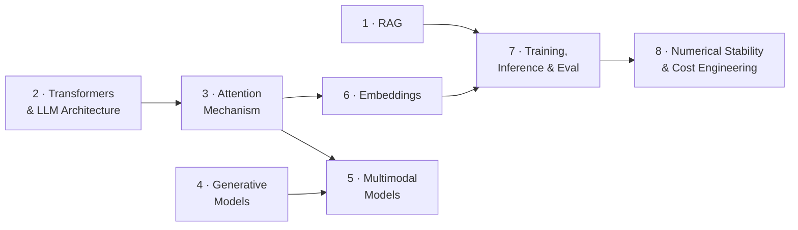

# GenAI / AI Engineer Interview Prep

**A structured question bank for AI Engineer and GenAI Data Scientist interviews.**

Most interview loops follow a similar shape: a first round of core ML/LLM fundamentals, then a project deep-dive. This guide is built for that first round — concise, well-organized answers you can actually recall under pressure, not a wall of prose to re-read the night before.

Each chapter groups questions by topic the way they tend to cluster in real interviews, with tables, code, and diagrams over long paragraphs wherever possible.

---

## Chapters

| # | Chapter | Topics | Questions |
|---|---|---|---|
| 1 | [Retrieval-Augmented Generation](chapters/01-rag.md) | Pipeline architecture, chunking, sparse vs. dense retrieval, re-ranking, RAG evaluation, agentic RAG evaluation, query transformation | Q1–Q12 |
| 2 | [Transformers & LLM Architecture](chapters/02-transformers-and-llms.md) | BERT vs. GPT, positional encoding, pre-training objectives, RLHF, catastrophic forgetting, transfer learning | Q1–Q15 |
| 3 | [Attention Mechanism](chapters/03-attention-mechanism.md) | QKV, scaled dot-product attention, multi-head attention, building a Transformer block, PagedAttention, cross-attention, RoPE, M-RoPE, ViT patch embeddings | Q1–Q12 |
| 4 | [Generative Models](chapters/04-generative-models.md) | GANs, VAEs, mode collapse, overfitting, gradient clipping/penalties, curriculum learning, L1 vs. L2 loss | Q1–Q12 |
| 5 | [Multimodal Models](chapters/05-multimodal-models.md) | CLIP, DALL-E, VisualBERT, cross-modal attention, Vision-Language Pre-training, data sparsity | Q1–Q12 |
| 6 | [Embeddings](chapters/06-embeddings.md) | Word vs. sentence embeddings, contextual embeddings, triplet loss, quantization, ANN search, OOV handling, ABSA pipelines | Q1–Q15 |
| 7 | [Training, Inference & Evaluation](chapters/07-training-inference-eval.md) | Overfitting, LR scheduling, long-context techniques, hallucination detection, MoE, temperature-0 non-determinism, BLEU/ROUGE/METEOR | Q1–Q10 |
| 8 | [Numerical Stability & Cost Engineering](chapters/08-numerical-stability-and-cost.md) | Stable sigmoid implementation, prompt caching, token-cost playbook | Q1–Q2 |

---

## Suggested reading paths

- **General AI Engineer round?** 3 → 2 → 1 → 7
- **GenAI Data Scientist / applied ML round?** 4 → 6 → 5 → 7
- **RAG/agent-heavy role?** 1 → 3 → 7 → 8
- **Deep architecture drill (expect whiteboard code)?** 3 → 2 → 4

---

## Also in this folder

- **[question_template.md](question_template.md)** — the submission format for adding a newly-found interview question to this bank (source, rough notes, difficulty) so it gets cleaned up and slotted into the right chapter consistently.
- **[img/](img/)** — figures referenced by the chapters above.

---

## See also

**[../genai-engg/](../genai-engg/)** — the companion field guide for *production* GenAI engineering questions (inference caching, context engineering, agent sandboxing, protocols, fine-tuning, security). This folder is the interview-fundamentals layer; `genai-engg` is the "how do you actually build and run this in production" layer. Expect the project deep-dive portion of an interview to draw more from there.

---

## Contributing

Found a question worth adding, or a better framing for an existing answer? Use [question_template.md](question_template.md) to submit it in a consistent format.
