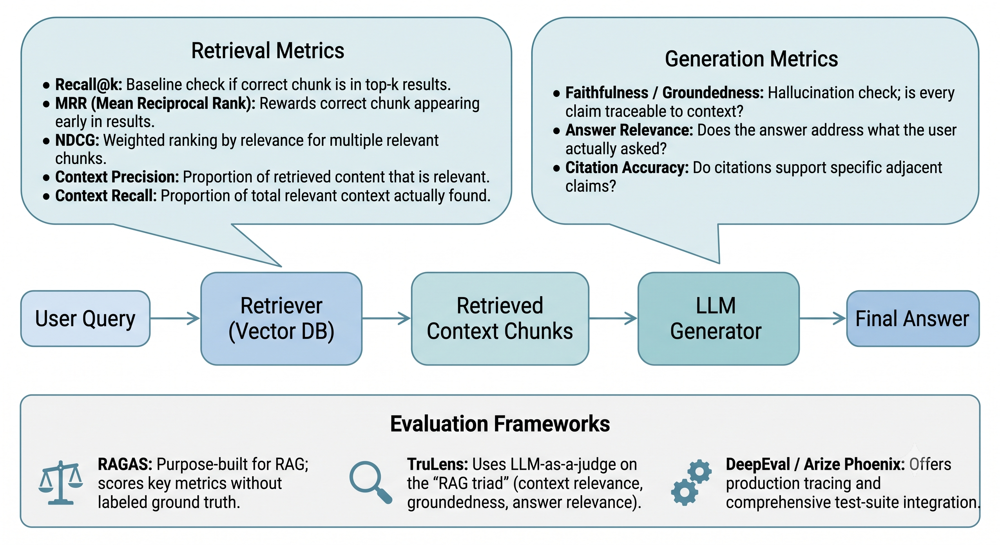
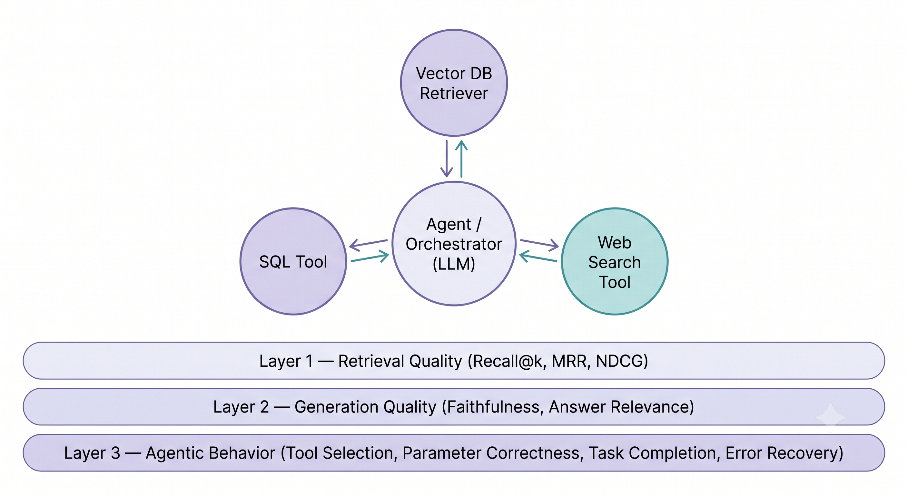

# Chapter 1 · Retrieval-Augmented Generation (RAG)

📚 **Further reading:** [RAG Cookbook](https://fareedkhan-dev.github.io/rag-cookbook-2026/)

---

### Q1. What is RAG, and why is it used?

RAG enhances LLM generation by retrieving relevant documents from an external knowledge base before generating a response. Instead of relying solely on parametric knowledge baked into the model's weights during training, RAG lets the model pull in up-to-date or domain-specific information at inference time.

**Why it's used:**
- **Reduces hallucination** — grounds responses in retrieved evidence.
- **Knowledge freshness** — incorporates recent information without retraining.
- **Domain specificity** — enables enterprise/private knowledge bases.
- **Transparency** — retrieved sources can be cited, making outputs auditable.

---

### Q2. Describe the high-level architecture of a RAG pipeline.

1. **Document ingestion** — raw documents (PDFs, web pages, etc.) are collected and preprocessed.
2. **Chunking** — documents are split into smaller, manageable chunks (e.g., 256–512 tokens).
3. **Embedding** — each chunk is converted to a vector embedding.
4. **Vector store** — embeddings are stored in a vector database (Pinecone, Weaviate, FAISS, Chroma).
5. **Query processing** — the user's query is embedded with the same embedding model.
6. **Retrieval** — top-k most similar chunks are retrieved via approximate nearest-neighbor search.
7. **Augmentation** — retrieved chunks are prepended to the prompt as context.
8. **Generation** — the LLM generates a response grounded in the retrieved context.

---

### Q3. What are the key chunking strategies in RAG, and how do they affect retrieval quality?

| Strategy | Description | Best for |
|---|---|---|
| **Fixed-size** | Split by character/token count | Simple, fast baseline |
| **Sentence-based** | Split at sentence boundaries | Preserves linguistic units |
| **Paragraph-based** | Split at paragraph breaks | Preserves thematic coherence |
| **Semantic** | Split when semantic similarity drops | Most context-aware, computationally expensive |
| **Hierarchical/recursive** | Split recursively into smaller units | Balances granularity and coherence |

Chunk size trades off recall (larger = more context) against precision (smaller = more targeted). Overlap between chunks (10–20%) helps preserve context at boundaries.

---

### Q4. What is the difference between sparse retrieval and dense retrieval?

| Aspect | Sparse (e.g., BM25) | Dense (e.g., DPR, embeddings) |
|---|---|---|
| Representation | TF-IDF / inverted index (bag of words) | Dense neural embeddings |
| Matching | Exact keyword matching | Semantic similarity |
| Speed | Very fast | Slower (ANN search) |
| Context | No contextual understanding | Captures semantic meaning |
| Out-of-vocabulary | Cannot match unseen words | Handles synonyms and paraphrases |

**Hybrid retrieval** combines both (e.g., BM25 + embedding re-ranking) to get keyword precision and semantic understanding together.

---

### Q5. What is re-ranking in RAG, and why does it matter?

Re-ranking is a post-retrieval step where an initial set of retrieved documents (e.g., top-50) is re-scored and reordered by a more powerful but slower cross-encoder model before the top-k results are passed to the LLM.

- Initial retrieval (bi-encoder) is fast but coarse; re-ranking improves precision.
- Cross-encoders jointly encode the query and document for more accurate relevance scoring.
- Fewer irrelevant chunks reach the LLM → better response quality, less hallucination.

**Example:** retrieve top-50 via cosine similarity, re-rank with a cross-encoder, pass top-5 to the LLM.

---

### Q6. How do you evaluate a RAG system?

A RAG pipeline can fail in two independent places — bad retrieval or bad generation — so evaluation needs to look at both layers separately before judging the system end-to-end. A wrong answer could mean the retriever missed the right chunk, or the generator ignored context that was actually correct. Treating it as one black box makes debugging nearly impossible.

**Retrieval metrics** — is the system finding the right information, and ranking it well?

| Metric | What it checks |
|---|---|
| **Recall@k** | Does the correct chunk appear anywhere in the top-k? Binary, ignores *where* it landed. |
| **MRR** (Mean Reciprocal Rank) | Rewards the correct chunk appearing *early*. A hit at position 9 counts for Recall@k but is nearly useless if the generator's context gets diluted by irrelevant chunks ahead of it. |
| **NDCG** | Extends this to queries with multiple relevant chunks of varying importance, weighting by both relevance and rank. |
| **Context Precision** | Of what was retrieved, how much was actually relevant? Catches noisy retrieval. |
| **Context Recall** | Of what *should* have been retrieved, how much was found? Catches missed context. |

**Generation metrics** — given the right context, did the model use it well?

| Metric | What it checks |
|---|---|
| **Faithfulness / Groundedness** | Is every claim traceable to the retrieved context? The main hallucination check — a fluent but ungrounded answer is often more dangerous than an obviously wrong one. |
| **Answer Relevance** | Does the answer address what the user actually asked? Can be fully faithful and still miss the question, which happens when retrieval pulls in tangentially related chunks. |
| **Citation Accuracy** | If the system cites sources, does the citation support the specific claim next to it — not just exist somewhere nearby? |

Most teams lean on end-to-end frameworks that bundle these metrics together:
- **RAGAS** — purpose-built for RAG; scores faithfulness, answer relevance, context precision, and recall without needing per-query ground truth.
- **TruLens** — LLM-as-a-judge on the "RAG triad" (context relevance, groundedness, answer relevance), plus tracing to pinpoint where a pipeline broke.
- **DeepEval / Arize Phoenix** — similar idea, with stronger production tracing and test-suite integration.



> **Interview one-liner:** "I evaluate retrieval and generation separately, then end-to-end — because great retrieval with poor generation still hallucinates, and great generation over bad retrieval just produces confident nonsense."

---

### Q7. What are common failure modes in RAG systems, and how can they be mitigated?

| Failure mode | Cause | Mitigation |
|---|---|---|
| **Retrieval miss** | Relevant doc not in top-k | Increase k, improve embedding model, add re-ranking |
| **Context overflow** | Too much retrieved text exceeds context window | Reduce k, better chunking, summarize chunks |
| **Semantic mismatch** | Query and document use different vocabulary | Hybrid retrieval (sparse + dense), query expansion |
| **Hallucination despite retrieval** | LLM ignores or misuses retrieved context | Prompt engineering, faithfulness fine-tuning |
| **Stale knowledge** | Knowledge base not updated regularly | Incremental indexing, time-based filtering |
| **Poor chunking** | Critical context split across chunks | Overlap chunking, semantic chunking |

---

### Q8. What is the role of the embedding model in a RAG pipeline, and how should it be selected?

The embedding model converts text (documents and queries alike) into dense vectors. Embedding quality directly determines retrieval quality.

**Selection criteria:**
- **Task alignment** — models trained for retrieval (`text-embedding-3`, `bge-large`, `e5-large`) outperform general-purpose embeddings.
- **Domain fit** — fine-tune or select models pre-trained on domain-specific data (legal, medical).
- **Context length** — ensure the model can handle your chunk size.
- **Benchmarks** — use MTEB (Massive Text Embedding Benchmark) scores as a reference for retrieval tasks.
- **Consistency** — query and document embeddings must use the **same model** for meaningful similarity scores.

---

### Q9. What is query transformation, and how does it improve RAG performance?

Query transformation modifies the user's query before retrieval to improve match quality:

- **Query rewriting** — rephrase ambiguous queries into clearer retrieval-friendly forms using an LLM.
- **HyDE (Hypothetical Document Embeddings)** — generate a hypothetical answer with the LLM, embed it, and retrieve using that embedding instead of the raw query. Helps when the query and relevant documents are stylistically different.
- **Multi-query expansion** — generate multiple variants of the query, retrieve for each, and merge results.
- **Step-back prompting** — transform specific queries into more general ones to retrieve broader context.

---

### Q10. What is the difference between naive RAG, advanced RAG, and modular RAG?

| Type | Description | Characteristics |
|---|---|---|
| **Naive RAG** | Basic retrieve-then-generate pipeline | Simple, fragile, limited optimization |
| **Advanced RAG** | Adds pre-retrieval (query rewriting) and post-retrieval (re-ranking, compression) steps | Better accuracy, handles edge cases |
| **Modular RAG** | Treats each step as an independent, swappable module | Highly flexible — custom pipelines, iterative retrieval, task-specific optimization |

Modern RAG frameworks (LangChain, LlamaIndex) largely implement modular RAG patterns, letting components like the retriever, re-ranker, and generator be mixed and matched.

---

### Q11. How do you evaluate an Agentic RAG system?

Agentic RAG adds a decision-making layer on top of classic RAG — instead of a fixed "retrieve then generate" pipeline, the model decides *whether* to retrieve, *which* tool or source to use, *how many times* to call it, and *when* it has enough information to answer. Evaluation has to cover everything a normal RAG system needs (is the retrieved context good, is the answer grounded in it) **plus** a new layer of agentic behavior (did it make the right decisions to get there). Judging only the final answer can hide a system that got the right result by accident — e.g., calling the wrong tool first, retrying blindly, or retrieving redundant context before stumbling onto the right chunk.

Evaluation breaks into three layers:

| Layer | Core question | Key metrics |
|---|---|---|
| **Retrieval quality** | Did the system find the right context? | Recall@k, MRR, NDCG, Context Precision, Context Recall |
| **Generation quality** | Did it use that context well? | Faithfulness/Groundedness, Answer Relevance, Citation Accuracy |
| **Agentic behavior** | Did it *decide and act* correctly to get there? | Tool Selection, Parameter Correctness, Task Completion, Error Recovery |

The first two layers are identical to classic RAG evaluation (Q6) — a poor answer is still either a retrieval problem or a generation problem underneath, regardless of how many tools were involved. The new layer is what makes agentic RAG harder to evaluate well:

- **Tool Selection** — given the query, did the agent pick the right tool or data source (vector DB vs. SQL vs. web search vs. no retrieval at all)? A common failure is over-retrieving — calling a search tool for a question the model could've answered directly, adding latency and hallucination risk for no benefit.
- **Parameter Correctness** — was the tool called with valid, well-formed inputs (correct filters, right date range, properly typed arguments)? A right tool choice with a malformed query still fails silently — a low-relevance retrieval that *looks* like a retrieval-quality problem but is actually an agent-reasoning problem.
- **Task Completion** — did the agent finish the user's goal end-to-end, including multi-step cases chaining 2–3 tool calls (retrieve → filter → summarize)? Closer to a pass/fail outcome metric than the granular per-step ones above.
- **Error Recovery** — when a tool call fails, times out, or returns empty results, does the agent retry sensibly, fall back to another tool, or hallucinate an answer instead of surfacing the failure? Often the single biggest gap between a demo-quality agent and a production one.

In practice, this layer needs *trace-level* data, not just final input/output pairs — you need the full sequence of tool calls, their parameters, and their results to tell whether a bad final answer came from bad retrieval, bad generation, or a bad decision upstream of both. Tracing frameworks (LangSmith, Arize Phoenix, TruLens) matter here as much as scoring frameworks (RAGAS) — RAGAS-style metrics score the retrieval/generation layers well, but agentic behavior scoring generally leans on LLM-as-a-judge over the full trace, or hand-labeled task-completion benchmarks for known query types.



> **Interview one-liner:** "Agentic RAG fails in three possible places — bad retrieval, bad generation, or bad decision-making about tools — so I evaluate all three layers using trace-level data, not just the final answer, because a correct-looking response can still hide an agent that got there inefficiently or by accident."

---

### Q12. How would you evaluate the quality of LLM-generated text summaries — and how does this generalize to other NLP tasks?

Use **G-Eval** (LLM-as-a-judge via DeepEval) — a judge model scores outputs using chain-of-thought reasoning against task-specific criteria. Generalizes to any NLP task by swapping the metric set.

**Core metrics for summarization:**

| Metric | What it measures |
|---|---|
| **Faithfulness** | No hallucinated content outside the source |
| **Coverage** | Key points of the source are captured |
| **Conciseness** | No repetition or filler |
| **Clarity** | Well-formed and readable |
| **Composite** | Sum of all four — max 4.0 |

**Same framework, different metrics for other tasks:**

| Task | Swap metrics for |
|---|---|
| RAG / context retrieval | Faithfulness, Context Recall, Context Precision, Answer Relevance |
| Translation | Adequacy, Fluency, Terminology |
| Chatbot / QA | Correctness, Helpfulness, Groundedness |

**Evaluation protocol:**

Run **5 independent rounds per example**, average the scores — single-round LLM evals have high variance. **Pass rate** = fraction of rounds where *all* metrics meet threshold, averaged across examples.

```
Example (n=200, 5 rounds each):

Example #1 scores across 5 rounds:
  Round 1: Faith=1, Cov=1, Conc=0, Clar=1 → composite=3.0 → pass (threshold ≥ 3.0) ✅
  Round 2: Faith=1, Cov=0, Conc=1, Clar=1 → composite=3.0 → pass ✅
  Round 3: Faith=1, Cov=1, Conc=1, Clar=1 → composite=4.0 → pass ✅
  Round 4: Faith=0, Cov=1, Conc=1, Clar=1 → composite=3.0 → pass ✅
  Round 5: Faith=1, Cov=1, Conc=0, Clar=0 → composite=2.0 → fail ❌

Pass rate for Example #1 = 4/5 = 0.80
Avg composite for Example #1 = (3+3+4+3+2)/5 = 3.0

Repeat for all 200 examples → average pass rate across dataset
```

**Statistical significance — paired t-test**, comparing Model A vs Model B on the same 200 examples:

```
For each example i:
  d_i = avg_composite(Model A) - avg_composite(Model B)

e.g. d_1 = 3.0 - 2.6 = +0.4  (A better on example 1)
     d_2 = 2.8 - 3.1 = -0.3  (B better on example 2)
     ...

t = mean(d) / (std(d) / sqrt(n))
  = 0.15 / (0.4 / sqrt(200))
  = 0.15 / 0.028 ≈ 5.3   → p < 0.05 → significant
```

Paired because the same example is tested under both conditions — removes example-level variance from the comparison.

**Key takeaway:** define your criteria → run multi-round LLM scoring → average → paired t-test. Same pipeline works across summarization, RAG, translation, and QA.

---

[← Back to index](../README.md) · [Next: Transformers & LLM Architecture →](02-transformers-and-llms.md)
