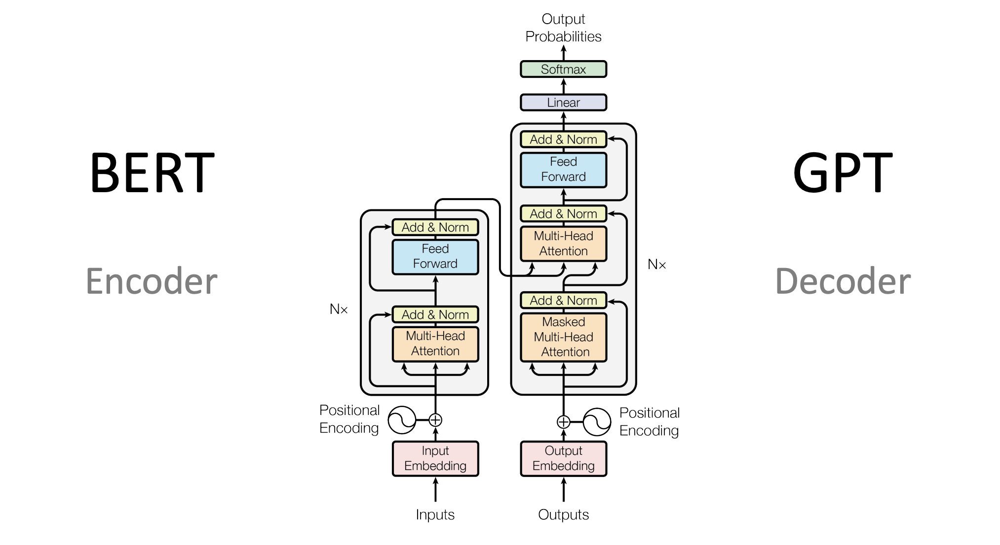
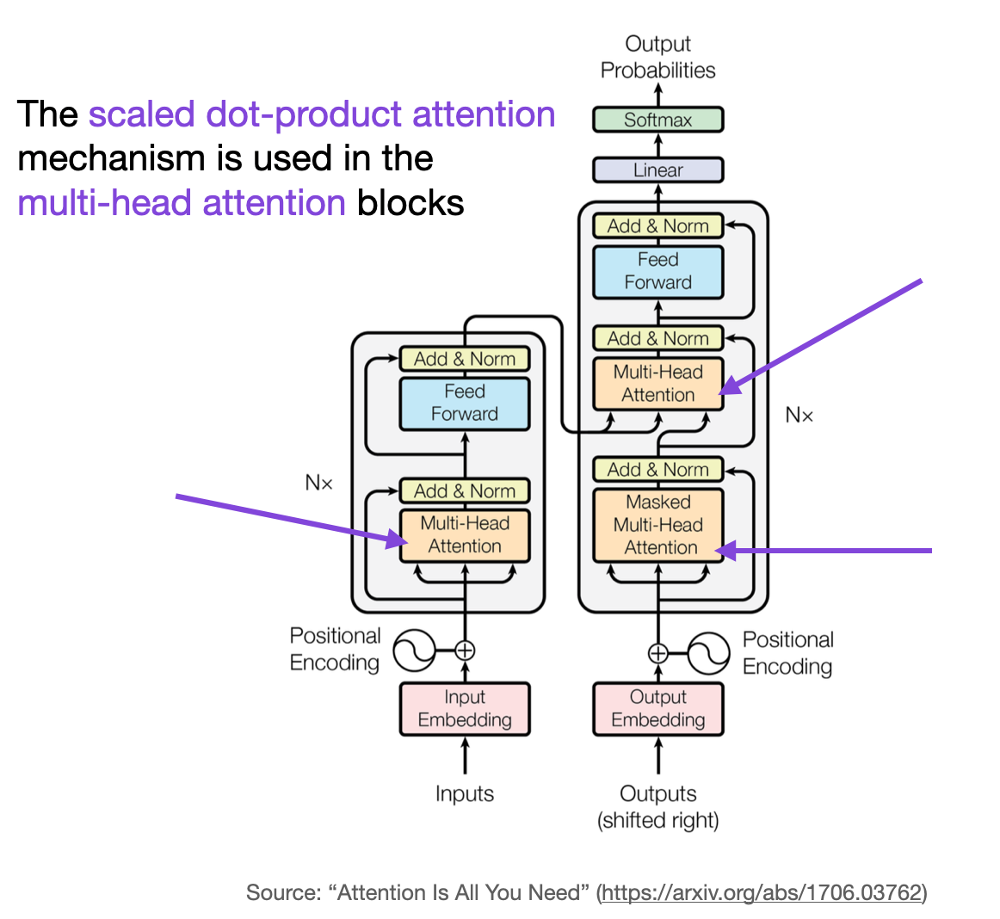
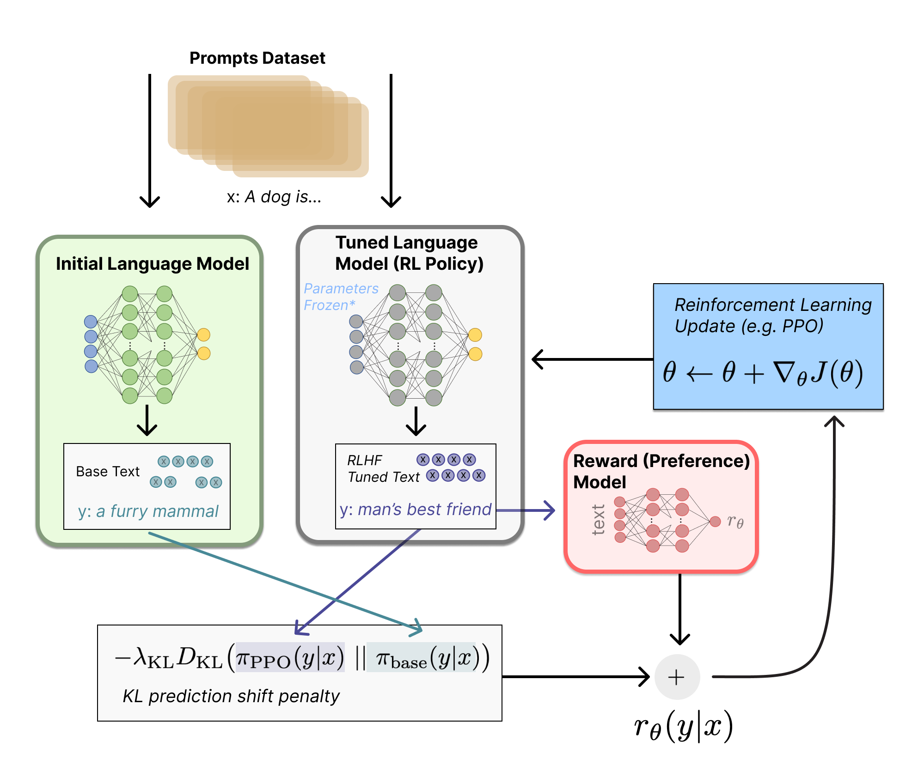

# Chapter 2 · Transformers & LLM Architecture

---

### Q1. What is BERT? What is GPT? How are they different?

Both are Transformer-based, but use different halves of the architecture and different training objectives.

- **BERT** = **B**idirectional **E**ncoder. Uses the Transformer **encoder**; each token attends to **both left and right** context. Trained with **Masked Language Modeling** (predict randomly masked tokens) + Next Sentence Prediction. → Great for *understanding* tasks: classification, NER, sentence embeddings, retrieval.
- **GPT** = **G**enerative **P**re-trained **T**ransformer. Uses the Transformer **decoder**; **causal/unidirectional** attention (a token sees only tokens *before* it). Trained to **predict the next token**. → Great for *generation*: chat, text completion, reasoning.

| | BERT | GPT |
|---|---|---|
| Architecture | Encoder | Decoder |
| Attention | Bidirectional | Causal (left-to-right) |
| Objective | Masked LM | Next-token prediction |
| Best at | Understanding | Generation |

> **One-liner:** BERT *reads* the whole sentence at once (understanding); GPT *writes* one token at a time (generation).

---

### Q2. What problems of RNNs do Transformer models solve?

- **Parallelization** — RNNs process data sequentially, which inherently limits parallelizing computation. Transformers use self-attention to process entire sequences simultaneously, drastically improving efficiency and training time.
- **Long-term dependencies** — RNNs struggle to capture long-range dependencies due to vanishing/exploding gradients. Transformers compute relationships between all parts of the input directly via self-attention, regardless of distance.
- **Scalability** — RNNs' sequential nature makes them less scalable for long sequences (compute/memory grow linearly with length). Transformers mitigate this through more efficient attention, though they still face quadratic-cost challenges on very long sequences without modifications (sparse attention, etc.).

---

### Q3. Why is positional encoding crucial in Transformer models?

Self-attention treats every element of the input independently — it has no inherent sense of order. Without positional encoding, a Transformer can't distinguish between the same set of tokens arranged in different orders ("the cat ate the fish" vs. "the fish ate the cat" would look identical to raw attention).

Positional encodings are added to the input embeddings so the model retains order information throughout self-attention and subsequent layers. Classic implementations use sinusoidal functions of different frequencies; modern LLMs mostly use **RoPE** instead (see [Chapter 3, Q10](03-attention-mechanism.md#q10-what-is-rope-rotary-position-embedding)).

---

### Q4. Why is incorporating *relative* positional information crucial? Where does it matter most?

Relative position encoding captures the order and proximity of elements rather than just absolute position — important wherever meaning depends on arrangement:

- **Language understanding/generation** — word order changes meaning ("The cat chased the mouse" vs. "The mouse chased the cat").
- **Sequence-to-sequence tasks** — machine translation and summarization need to track relative ordering to preserve meaning and identify key points.
- **Time-series data** — relative positioning captures causality and trends over time.

---

### Q5. What challenges arise from the vanilla Transformer's fixed attention span?

The vanilla Transformer has a fixed attention span limited by max sequence length, because self-attention cost grows **quadratically** with sequence length (both compute and memory).

This hurts:
- **Long documents** — summarization or long-form QA may need information spread across pages the model can't fully integrate.
- **Contextual coherence** — narrative or dialogue where early context affects later meaning can get cut off by the fixed window.

### Q5b. Why can't you just naively increase context length to fix this?

Because the quadratic cost means doubling sequence length **quadruples** compute and memory:
- **Computational cost** — processing longer sequences slows both training and inference significantly.
- **Memory constraints** — demand can exceed available GPU memory, limiting feasibility at scale.

(Production fixes — FlashAttention, MQA/GQA, RoPE scaling, sparse attention, ALiBi — are covered in [Chapter 3](03-attention-mechanism.md) and in the long-context techniques in Q-training below.)

---

### Q6. How does self-attention work?

Self-attention weighs the importance of different parts of the input relative to each other — every output element is a weighted sum over a function of all input elements.

1. **Query, Key, Value vectors** — for each input token, the model generates Q, K, V vectors via learnable weight matrices.
2. **Attention scores** — dot product of one token's Query with every token's Key, followed by softmax normalization. These scores determine how much focus each token gives every other token.
3. **Weighted sum** — scores are used to compute a weighted sum of Value vectors, forming the output for each position.

(Full formula, scaling, and multi-head mechanics are in [Chapter 3](03-attention-mechanism.md).)

---

### Q7. What pre-training mechanisms are used for LLMs?

| Mechanism | Used by | Idea |
|---|---|---|
| **Masked Language Modeling (MLM)** | BERT | Randomly mask input tokens, train the model to predict them from context — deep bidirectional understanding. |
| **Causal (autoregressive) LM** | GPT | Predict the next token given only preceding tokens — effective for generation. |
| **Permutation LM** | XLNet | Predict a token given the others, with input order permuted — encourages flexible, context-aware understanding. |

---

### Q8. Why is multi-head attention needed?

A single attention head is forced to average over *all* kinds of relationships (syntax, position, long-range dependency, coreference…) into one score. Multi-head attention runs several attention mechanisms in parallel, each with its own learned weights, so the model can jointly attend to different representation subspaces:

- **Richer representation** — different heads can capture different aspects (syntactic vs. semantic) in parallel.
- **Improved focus** — different heads balance local vs. global information.
- **Increased capacity** — more capacity to learn complex patterns, without a large compute increase since heads run in parallel with smaller dimensions each.

---

### Q9. What is RLHF, and how is it used?

Reinforcement Learning from Human Feedback aligns a language model's outputs with human preferences, values, and ethics.

1. **Pre-training** — the model learns a broad understanding of language on a large text corpus.
2. **Human feedback collection** — annotators review model outputs and provide feedback/corrections.
3. **Reinforcement learning** — the model is fine-tuned using RL, with human feedback as the reward signal, pushing outputs to align with human judgments.

Particularly useful for tasks requiring strong alignment with human values — safe/unbiased content, higher-quality conversational agents, ethically sound AI-generated advice.

 · [Further reading: Hugging Face RLHF blog](https://huggingface.co/blog/rlhf)

---

### Q10. What is catastrophic forgetting in the context of LLMs?

The phenomenon where a neural network forgets previously learned information upon learning new information. Training adjusts weights to minimize loss on new data, which can inadvertently erase what was learned from earlier data. Especially challenging when models need to continuously learn from new data streams without degrading performance on older tasks.

---

### Q11. In a Transformer encoder-decoder model, what are the roles of the encoder and decoder, and how does information flow between them?

- **Encoder** — processes the input sequence, capturing content and contextual relationships, and transforms it into continuous representations the decoder can use.
- **Decoder** — receives the encoder's representations and generates the output sequence one element at a time, using the encoder's output plus previously generated elements to produce the next one.

Information flows primarily through the encoder's output representations. The decoder also uses self-attention over its own previous outputs for coherence, and in many variants uses **cross-attention** to attend directly to encoder outputs at each decoding step (see [Chapter 3, Q9](03-attention-mechanism.md#q9-what-is-cross-attention-how-do-image--text-attention-work-together)).

---

### Q12. What strategies help transfer a pre-trained Transformer to a domain-specific task?

- **Domain-specific pre-training** — continue pre-training on a large domain corpus before task fine-tuning, to absorb domain vocabulary and style.
- **Gradual unfreezing** — fine-tune only the last few layers first, unfreezing more as training progresses, to avoid catastrophic forgetting while adapting to the new task.
- **Differential learning rates** — smaller learning rates for earlier (general-knowledge) layers, higher rates for later (task-specific) layers.
- **Task-specific architectural adjustments** — add a classification head, sequence-generation head, etc., matching the target task.
- **Data augmentation** — back-translation, synonym replacement, paraphrasing to increase training diversity.
- **Regularization** — dropout, label smoothing, weight decay to avoid overfitting on the smaller task-specific dataset.

---

### Q13. Discuss transfer learning in NLP. How do pre-trained LMs contribute across tasks?

Two phases:

1. **Pre-training** — unsupervised/semi-supervised training on a large corpus to learn general language structure (syntax, semantics, context).
2. **Fine-tuning** — the pre-trained model is adapted on a smaller, task-specific dataset while retaining its general language understanding.

**Contributions of pre-trained LMs:**
- **Improved performance** — new benchmarks across classification, NER, translation, etc.
- **Training efficiency** — strong results with much less task-specific data and compute.
- **Versatility** — the same base model fine-tunes across many tasks and domains.
- **Contextual understanding** — models like BERT/RoBERTa/GPT-3 capture nuanced word meaning from context, crucial for context-dependent tasks like sentiment analysis.

---

### Q14. Compare sparse (cross-entropy) and dense (MSE) loss functions for training language models.

- **Sparse loss (cross-entropy)** — standard for classification/next-token prediction over a large vocabulary. Measures the gap between the predicted probability distribution and the true one-hot distribution. Directly penalizes low probability on the correct word, matching the discrete nature of language.
- **Dense loss (MSE)** — measures average squared error, suited to regression/continuous outputs. Rarely used for next-word prediction directly, but applicable to embedding-based or continuous-output sub-tasks (e.g., matching generated embeddings to target embeddings).

**Impact:** cross-entropy aligns with language's probabilistic/discrete nature and is standard for LM training; MSE fits continuous-output NLP tasks but is a poor fit for categorical word prediction.

---

### Q15. How can reinforcement learning be integrated into LLM training, and what challenges arise in choosing loss functions?

This is the RLHF pattern in more technical detail:

1. **Reward modeling** — train a reward model to predict output quality against task-relevant criteria (coherence, relevance, ethics), using human-rated examples.
2. **Policy optimization** — fine-tune the LLM (the "policy") using gradients derived from the reward model, pushing it to maximize predicted reward.

**Challenges:**
- **Defining the reward function** — must comprehensively capture desired behavior without encoding unintended bias.
- **Variance and stability** — RL training can be high-variance due to sparse/delayed rewards, making gradient estimation harder than supervised loss.
- **Reward shaping and alignment** — rewards must target long-term goals, not just short-term superficial optimization; often needs careful reward shaping or constrained optimization.

---

[← Previous: RAG](01-rag.md) · [Back to index](../README.md) · [Next: Attention Mechanism →](03-attention-mechanism.md)
