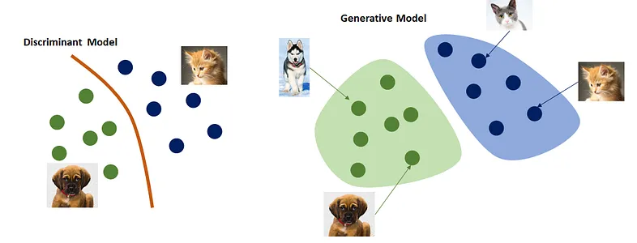
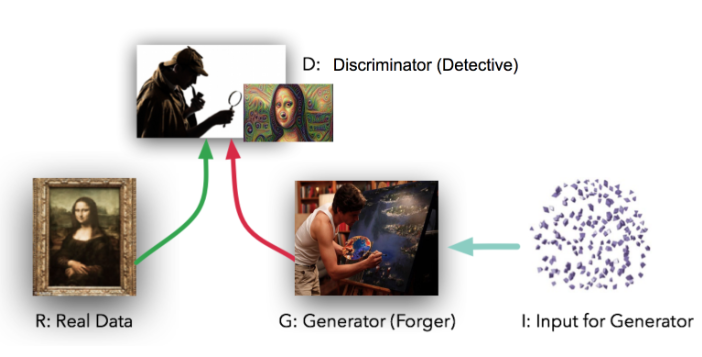
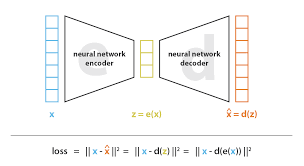

# Chapter 4 · Generative Models

---

### Q1. What is the difference between generative and discriminative models?

Generative models (VAEs, GANs) are designed to generate new data samples by learning the underlying data distribution. Discriminative models focus on distinguishing between classes or categories within the data, without modeling how the data was generated.

*Image source: [medium.com/@jordi299](https://medium.com/@jordi299/about-generative-and-discriminative-models-d8958b67ad32)*

---

### Q2. Describe the architecture of a GAN, and how the generator and discriminator interact during training.

A GAN comprises a **generator** and a **discriminator**. The generator produces synthetic data, attempting to mimic real data; the discriminator evaluates the authenticity of generated samples. During training, the two engage in a dynamic interplay — the generator tries to produce more realistic data while the discriminator tries to get better at telling real from fake.

*Image source: [climate.com](https://climate.com/tech-at-climate-corp/gans-disease-identification-model/)*

---

### Q3. Explain the concept of a Variational Autoencoder (VAE) and how it incorporates latent variables.

A VAE consists of an **encoder** and a **decoder** network.

*Image source: [towardsdatascience.com](https://towardsdatascience.com/understanding-variational-autoencoders-vaes-f70510919f73)*

The encoder maps input data to a probability distribution in latent space — instead of a single latent vector, it outputs parameters of a (typically Gaussian) distribution, representing uncertainty in the latent representation. This stochastic process allows sampling from the latent space.

The decoder takes sampled latent vectors and reconstructs the input. Training minimizes the reconstruction error between input and decoded output, while also minimizing the discrepancy between the learned latent distribution and a prior (usually a standard Gaussian).

By embedding latent variables, a VAE learns a compact, continuous representation that enables meaningful interpolation and generation of new samples, and the probabilistic latent space allows uncertainty estimation in the outputs.

---

### Q4. How do conditional generative models differ from unconditional ones?

Unconditional models (vanilla GANs/VAEs) learn to generate samples based solely on the underlying data distribution. Conditional generative models condition the generation process on additional input variables or labels, giving precise control over outputs.

**Example scenarios:**
- **Image-to-image translation** (e.g., day→night) — a conditional model learns the mapping between input and output domains from paired data.
- **Text-to-image synthesis** — given a textual description, the model generates a matching image.

Conditional models offer greater flexibility and control, making them well-suited for tasks requiring specific constraints or tailored generation.

---

### Q5. What is mode collapse in GANs, and how do you address it?

Mode collapse is when the generator produces limited diversity, sticking to a few modes/patterns in the data distribution instead of capturing its full richness — resulting in repetitive or homogeneous outputs.

**Mitigation strategies:**
1. **Architectural modifications** — increase generator/discriminator capacity, add skip connections, use more complex architectures (DCGAN, PGGAN).
2. **Mini-batch discrimination** — compute statistics across multiple samples in a mini-batch so the discriminator can detect mode collapse and push the generator toward diversity.
3. **Diverse training data** — ensure the dataset itself isn't skewed or lacking diversity.
4. **Regularization** — weight regularization, dropout, spectral normalization reduce overfitting and encourage diverse feature learning.
5. **Dynamic learning rates** — learning-rate schedules or adaptive algorithms stabilize the generator/discriminator balance.
6. **Ensemble methods** — train multiple GANs with different initializations/architectures and combine outputs for more varied, realistic samples.

---

### Q6. How does overfitting manifest in generative models, and how do you prevent it?

**Manifestations:**
- **Mode collapse** — limited sample variety (see Q5).
- **Poor generalization** — outputs resemble training data closely but lack diversity or miss the true distribution's nuances.
- **Artifacts/inconsistencies** — distorted images, implausible text, nonsensical outputs.

**Prevention:**
1. **Regularization** — weight decay, dropout, batch normalization.
2. **Early stopping** — monitor validation performance, stop before it degrades.
3. **Data augmentation** — cropping, rotation, scaling, noise to widen the effective training distribution.
4. **Adversarial training** — the generator/discriminator dynamic itself discourages memorization and encourages diverse, realistic samples.
5. **Ensemble methods** — combine multiple models to reduce reliance on any single model's memorized quirks.
6. **Cross-validation** — more reliable performance estimates on unseen data.

---

### Q7. What is gradient clipping, and how does it stabilize generative model training?

Gradient clipping caps the magnitude of gradients once they exceed a threshold, commonly used in GANs and VAEs.

1. **Prevents exploding gradients** — deep architectures can produce gradients that blow up, causing numerical instability. Clipping bounds them.
2. **Mitigates oscillations** — the generator/discriminator (or encoder/decoder) interplay can cause gradients to swing widely; clipping dampens this for smoother updates.
3. **Enhances convergence** — more consistent, predictable parameter updates, avoiding extreme values that stall progress.
4. **Improves robustness** — makes training less sensitive to hyperparameter choices like learning rate or batch size.

---

### Q8. How do you train generative models with a limited dataset?

1. **Data augmentation** — rotation, scaling, cropping, noise to increase effective diversity.
2. **Transfer learning** — fine-tune a model pre-trained on a larger dataset instead of training from scratch.
3. **Semi-supervised learning** — combine a small labeled set with the larger unlabeled set via joint supervised + unsupervised objectives.
4. **Regularization** — dropout, weight decay, batch norm to discourage memorization.
5. **Progressive growing GANs (PGGAN)** — start at low resolution, incrementally add detail — lets the model learn coarse structure before fine detail even with limited data.
6. **Ensemble methods** — combine multiple models trained with different initializations/architectures.
7. **Data synthesis** — use a GAN/VAE itself to generate synthetic samples that augment the limited real dataset.

---

### Q9. How does curriculum learning apply to training generative models?

Curriculum learning starts training on simpler examples and gradually introduces more complex ones, mirroring how humans learn. For generative models, "simpler" might mean shorter sentences/common vocabulary (text) or images with fewer objects/less detail (vision).

**Advantages:**
1. **Improved learning efficiency** — basic patterns are learned quickly before tackling harder ones.
2. **Enhanced performance** — a solid foundation on simple tasks often improves generalization to complex ones.
3. **Stabilized training** — gradual complexity increase reduces the risk of getting stuck in poor local minima early on.
4. **Reduced overfitting** — learning general patterns first, before memorizing complex specifics.

---

### Q10. What is learning rate scheduling, and what role does it play in training generative models?

Learning rate scheduling adjusts the step size used for weight updates over the course of training. Too high → the model overshoots the optimum; too low → training stalls or is painfully slow.

**Role in generative model training:**
1. **Avoids overshooting** — a high early learning rate speeds convergence; gradually reducing it lets the model fine-tune without overshooting near the optimum.
2. **Speeds up convergence** — larger early updates move the model toward a good region faster.
3. **Improves performance** — careful scheduling helps escape suboptimal local minima/saddle points.
4. **Adapts to training dynamics** — e.g. in GANs, the generator/discriminator balance shifts over training; adaptive scheduling helps maintain it.

**Common strategies:** step decay, exponential decay, cosine annealing, warm-up schedules (gradual increase from small to large, useful for stabilizing very deep models early on).

---

### Q11. Compare L1 and L2 loss for generative models. When would you prefer one over the other?

- **L1 (absolute) loss** — sums absolute differences; less sensitive to outliers (treats all deviations the same). Leads to sparser gradients and more robust-to-noise models. Produces less-smooth, sharper-detail outputs — good for tasks needing sharp transitions (e.g., super-resolution).
- **L2 (squared) loss** — sums squared differences; more sensitive to outliers (large deviations penalized heavily). Encourages smaller, more incremental parameter changes → smoother outputs — good where output continuity matters (e.g., realistic textures).

**Preference:**
- **L1** when robustness to outliers or precise edges/detail fidelity matters.
- **L2** when smoother outputs are desired and the error distribution is roughly Gaussian.

---

### Q12. In GANs, what is the purpose of gradient penalties, and how do they address training instability?

GANs are notorious for instability, mode collapse, and vanishing gradients. Gradient penalties regularize the discriminator's gradients so they don't become too large — a common source of instability.

**Mechanism:** penalizing large gradients encourages smoother discriminator decision boundaries, which provide more meaningful gradients to the generator during backprop. This enforces a **Lipschitz continuity** condition on the discriminator — bounding how fast its output can change relative to its input — which stabilizes training by preventing excessively large updates.

**Effects:**
1. **Improved gradient flow** between discriminator and generator.
2. **Prevention of mode collapse** — consistent, diversified feedback encourages broader exploration of the data distribution.
3. **Enhanced robustness** to hyperparameter choices and initialization.
4. **Smoother decision boundaries** → more nuanced gradients for the generator.

**Examples:**
- **WGAN-GP** (Wasserstein GAN with Gradient Penalty) — adds a gradient penalty term to enforce the Lipschitz constraint.
- **Spectral normalization** — not technically a gradient penalty, but similarly controls the discriminator's Lipschitz constant by normalizing its weights.

---

[← Previous: Attention Mechanism](03-attention-mechanism.md) · [Back to index](../README.md) · [Next: Multimodal Models →](05-multimodal-models.md)
