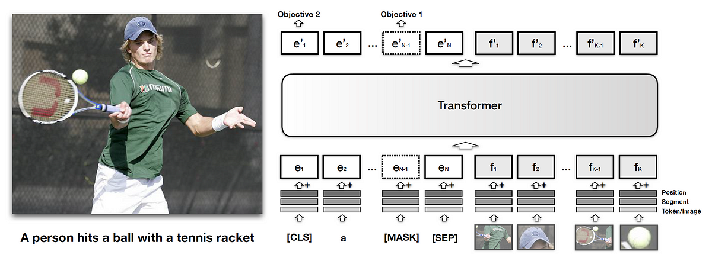
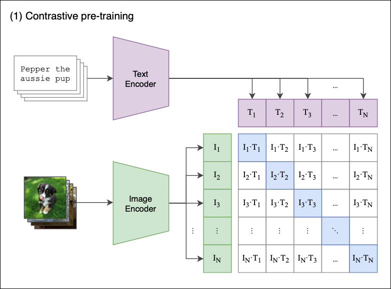

# Chapter 5 · Multimodal Models

*(Includes non-generative models)*

---

### Q1. How is information from visual and textual modalities integrated for tasks like captioning or VQA?

Multimodal models typically combine CNNs for image processing with Transformers/RNNs for text, integrating information through:

- **Joint embedding space** — both modalities are mapped to a common space where representations can be compared directly.
- **Attention mechanisms** — cross-modal attention lets the model focus on specific parts of an image given a textual query (or vice versa).
- **Fusion layers** — features from both modalities are combined via concatenation, element-wise addition, or more complex interactions, feeding tasks like image captioning or visual question answering.

---

### Q2. What role does cross-modal attention play in models like VisualBERT or CLIP?

Cross-modal attention lets one modality (e.g., text) dynamically guide the attention process in the other (e.g., image), highlighting the features most relevant to the task.

- **VisualBERT** — uses cross-modal attention inside the transformer to attend to specific image regions based on textual context — crucial when visual context is needed to interpret text correctly.

  

- **CLIP** — doesn't use cross-modal attention the same way. Instead, it trains on a vast dataset of image-text pairs using **contrastive learning**, maximizing similarity between corresponding image/text embeddings while minimizing it for non-corresponding pairs.

Both approaches let the model understand and leverage relationships between visual and textual elements, improving performance on tasks needing nuanced cross-modal understanding.

---

### Q3. How is training data typically annotated for image-text matching tasks, and what should you watch for?

Training data consists of image/text pairs closely aligned in content and context.

- **Manual annotation** — human annotators describe images or verify existing descriptions; requires careful guidelines for consistency and accuracy.
- **Automated techniques** — scraping image-caption pairs from the web, followed by cleaning/verification to maintain quality.

**Considerations:** diversity (imagery and language), bias (avoid reinforcing stereotypes or excluding groups), specificity (descriptions detailed and closely aligned with visual content), and scalability of the annotation process for large datasets.

---

### Q4. What loss functions are common for image synthesis, and how do they contribute to training?

- **Pixel-wise (MSE/MAE)** — measures per-pixel difference; straightforward, ensures overall fidelity, but doesn't capture perceptual similarity well.
- **Adversarial loss (GANs)** — a discriminator distinguishes real from generated images, pushing the generator toward realism.
- **Perceptual loss** — compares high-level features from a pre-trained network, capturing perceptual/semantic similarity rather than exact pixel match.

---

### Q5. What is perceptual loss, and how does it differ from pixel-wise loss?

Perceptual loss measures the difference between high-level features of generated and target images, extracted from a pre-trained CNN (usually trained on image classification).

**Usage:** guides generative models toward outputs similar in *content and style* rather than exact pixel values — useful for style transfer, super-resolution, and photorealistic synthesis.

**Difference from pixel-wise loss:** pixel-wise losses (MSE/MAE) compare exact corresponding pixels; perceptual loss operates at a higher abstraction level, capturing textures, shapes, and patterns that align much better with human visual perception.

> For a full production implementation (truncated VGG19, `gt.detach()`, MeanShift fusion, VRAM/latency numbers), see [`projects/model_optimization/sobel_and_vgg_perceptual_loss.md`](../../projects/model_optimization/sobel_and_vgg_perceptual_loss.md).

---

### Q6. What is masked language-image modeling?

A training technique for learning joint representations of text and visual information — analogous to BERT's MLM, but across modalities. Parts of both image and text input are randomly masked, and the model predicts the masked elements from the surrounding context in both modalities.

- **In images** — mask image regions, predict missing content from surrounding visual context (and any associated text).
- **In text** — mask words/phrases, predict them using visual context plus remaining text.

This forces the model to build a deep, integrated understanding across modalities, improving tasks requiring nuanced cross-modal reasoning.

---

### Q7. How do cross-attention weights influence generation in multimodal models?

Attention weights from cross-attention dynamically determine how much importance to give different parts of the input, across modalities:

- **Highlighting relevant information** — e.g., when captioning an image, the model focuses on image regions most pertinent to the words being generated.
- **Balancing modalities** — the model can lean more on text or more on vision depending on task and context; attention adjusts this balance dynamically.
- **Enhancing contextual understanding** — drawing on both modalities produces richer, more accurate, more contextually appropriate outputs.

---

### Q8. What unique challenges arise in training multimodal generative models vs. unimodal ones?

- **Data alignment** — matching specific image regions with corresponding text requires sophisticated modeling to capture the relationship accurately.
- **Complexity and scalability** — different modalities need different processing pipelines; managing this while scaling to large datasets is hard.
- **Cross-modal coherence** — generated output must make sense across all modalities simultaneously (e.g., an image accurately reflecting a text description).
- **Diverse data representation** — pixels (images) vs. tokens (text) are inherently different; the architecture must handle both while learning meaningful cross-modal interactions.
- **Sparse data** — comprehensive datasets covering the full space of possible modality combinations are often unavailable.

---

### Q9. How do multimodal generative models address data sparsity?

- **Data augmentation** — generate new image-text pairs via transformations/translations.
- **Transfer learning** — leverage models pre-trained on large unimodal datasets as a foundation.
- **Few-shot / zero-shot learning** — generalize to new, unseen examples with minimal or no extra training data.
- **Synthetic data generation** — generate examples of underrepresented modalities/combinations to balance the dataset.
- **Regularization** — prevent overfitting to the limited data that is available.

---

### Q10. What is Vision-Language Pre-training (VLP), and why does it matter?

VLP trains models on large datasets containing both visual and textual data to learn general representations that transfer to specific vision-language tasks. It's significant because it captures rich cross-modal semantic relationships, improving downstream performance on VQA, captioning, and text-based image retrieval — often with relatively small fine-tuning datasets, since the heavy lifting happened during pre-training.

---

### Q11. How do CLIP and DALL-E demonstrate vision-language integration?

- **CLIP** (Contrastive Language-Image Pre-training) — learns visual concepts from natural language descriptions, training on diverse image-text pairs with contrastive learning to align image and text representations in a shared embedding space. Generalizes across vision tasks using natural language as input, without task-specific training data.
- **DALL-E** — generates images from textual descriptions, using a GPT-3-style architecture adapted for image generation. Demonstrates deep joint understanding of described content and its visual representation.

Both show how deep learning can bridge textual description and visual representation for creative, flexible applications.

---

### Q12. How do attention mechanisms enhance vision-language model performance?

- **Cross-modal attention** — attends to specific image regions given textual input (or vice versa), improving tasks like captioning and VQA by focusing on the most relevant details.
- **Self-attention in language** — emphasizes important words/phrases within the text relevant to the visual data.
- **Self-attention in vision** — highlights important regions/features within an image, aligning them with textual descriptions or queries.

Together, these let vision-language models achieve more nuanced, context-aware, and coherent multimodal outputs.

---

[← Previous: Generative Models](04-generative-models.md) · [Back to index](../README.md) · [Next: Embeddings →](06-embeddings.md)
